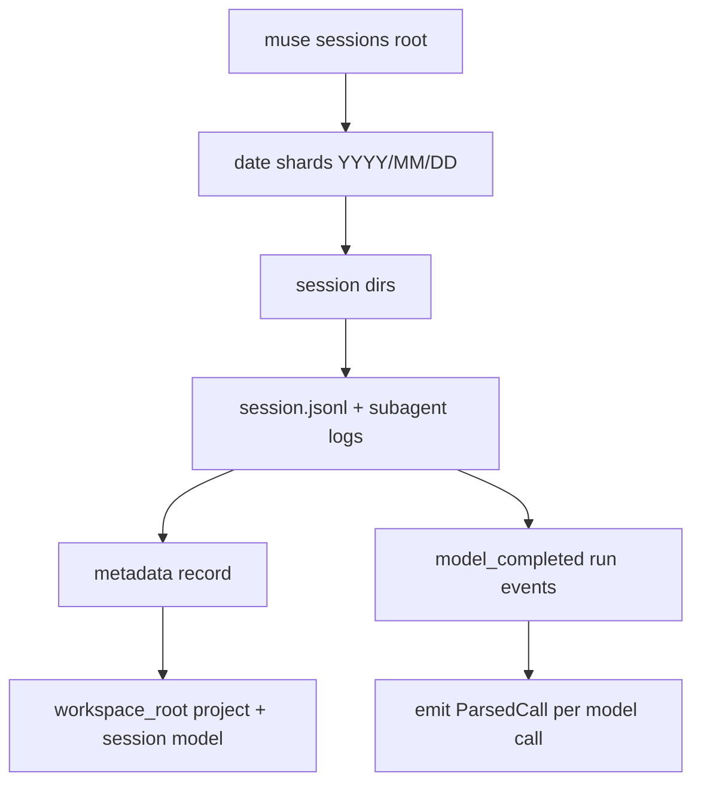

# Muse Code

Muse Code writes one event-sourced JSONL transcript per session under
`${XDG_DATA_HOME:-~/.local/share}/muse/sessions/YYYY/MM/DD/<session-id>/session.jsonl`
(the same XDG-style path on every platform, including Windows), with one
subagent transcript per delegated child in
`subagent/<child-session-id>/session.jsonl` beside the parent session.

> Status: implemented (`src/tools/muse_code/`).

## Where the data lives

| Path | Notes |
| --- | --- |
| `~/.local/share/muse/sessions/YYYY/MM/DD/<id>/session.jsonl` | Main event log, one JSON envelope per line |
| `~/.local/share/muse/sessions/YYYY/MM/DD/<id>/subagent/<child>/session.jsonl` | Delegated subagent logs, same format |

**Env var override:** `MUSE_SESSIONS` points directly at the sessions
directory. This is first-party: Muse's own session tooling resolves the
same variable, defaulting to `${XDG_DATA_HOME:-$HOME/.local/share}/muse/sessions`
(verified against the shipped `muse` binary's embedded strings).
`XDG_DATA_HOME` is honored when set; otherwise the default is
`~/.local/share/muse`. Muse uses this XDG-style layout on every platform,
including Windows — there is no separate `AppData` location and no
`MUSE_DATA_DIR`/`MUSE_HOME` support in the CLI itself (those names come
from third-party tools' own overrides, not Muse).

**Discovery rules** (`src/tools/muse_code/discovery.rs`):
- Walk the date-sharded tree (max depth covers `subagent/` nesting).
- Match files named exactly `session.jsonl`.
- Use the relative parent directory as the fallback project label; the
  parser replaces it with the real working directory (below).



## Record format

Each line is an event-log envelope:

```jsonc
{
  "id": "…",                       // unique per record; dedup key source
  "sequence": 42,
  "recorded_at": 1794511211509309, // microseconds since epoch
  "payload_type": "runtime.session",
  "payload": { "kind": "run", "event": { "kind": "model_completed", /* … */ } },
  "stream": { "kind": "session", "id": "<session-id>" }
}
```

The two payload kinds the parser reads:

```jsonc
// metadata: project + session model (one per log)
{ "kind": "metadata", "record": {
    "workspace_root": "/Users/me/proj",
    "model_id": "muse-spark-1.3-contributor" } }

// run event: exact per-model-call usage
{ "kind": "run", "event": {
    "kind": "model_completed",
    "usage": { "input_tokens": 38141, "output_tokens": 262,
               "cached_tokens": 0, "cache_write_tokens": 0,
               "cache_read_tokens": 0, "reasoning_tokens": 136 },
    "duration_ms": 4707,
    "finish_reason": "tool_calls",
    "model": "muse-spark-1.3-contributor" } }
```

Non-`model_completed` run events (tool batches, reasoning commits,
assistant messages) and all other payload kinds are ignored. Malformed
lines are skipped.

## Token & cost mapping

One `ParsedCall` is emitted per `model_completed` event. Observed logs
always carry all six usage fields on these events.

| `ParsedCall` field | Source |
| --- | --- |
| `input_tokens` | `usage.input_tokens` − `usage.cache_read_tokens` |
| `output_tokens` | `usage.output_tokens` |
| `cached_input_tokens` | `usage.cache_read_tokens` |
| `cache_read_input_tokens` | `usage.cache_read_tokens` |
| `cache_creation_input_tokens` | `usage.cache_write_tokens` |
| `reasoning_tokens` | `usage.reasoning_tokens` |
| `model` | event `model`, falling back to the session `model_id` |
| `timestamp` | envelope `recorded_at` (exact quality) |
| `project` | `metadata.workspace_root`, falling back to the discovery label |
| `session_id` | envelope `stream.id` |

Observed on real logs: `cached_tokens` duplicates `cache_read_tokens`,
so only the read leg enters cost math. Per [Meta's token-counting
docs](https://dev.meta.ai/docs/prompt-caching), the cached prefix is a
subset of `input_tokens`, not an extra charge — so the parser subtracts
the cached leg before billing input at the full rate (same shape as the
Gemini adapter). `estimated_prompt_tokens`, which rides on other run
events, is never used for pricing. Muse pricing rows live in
`costs/pricing-overrides.json` (Spark family rates with provenance).
See [Pricing and cache rates](../pricing.md).

## Deduplication

`dedup_key = "muse-code:{envelope id}"`, falling back to
`muse-code:{stream}:{sequence}` when an id is absent. Parent and
`subagent/` logs carry distinct envelope ids, so fan-out never double
counts, and the shared cross-adapter `seen` set plus the archive's
`(tool, dedup_key)` uniqueness let changed sources re-parse without
duplicating history.

The adapter prefixes its source fingerprints with
`muse-code-v1-model-completed`; bumping that constant forces archived
sessions back through the parser after an extraction change.

## Coach signals

v1 populates cost/usage identity only: exact token and timestamp quality,
no transcripts, no tool/bash extraction, no elapsed timing, no edited or
referenced files, `is_canceled` always `false`. Assistant text exists in
the log but is deliberately not captured yet.

## Known limitations

- `muse-wonder-*` models resolve to the official Standard-mode Wonder
  row (`muse-wonder-1.0`); newer Wonder variants fall back to the
  pricing-table fallback path and the Models page marks them as
  estimates until an alias lands.
- `cache_write_tokens` is uniformly zero in observed logs and Meta
  publishes no separate cache-write price, so that leg mirrors the input
  rate until either changes.
- Sessions without a `metadata` record fall back to the date-shard
  relative path as the project label.
- Muse limit snapshots are not imported: there is no subscription
  sidecar for Muse Code.
- The format is undocumented and moves with Muse releases; the parser
  reads only `model_completed` + `metadata` and ignores the rest.
